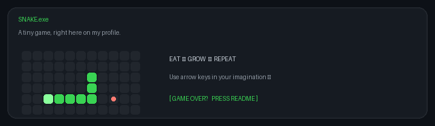

# Olá, eu sou Elton Costa 👋

Desenvolvedor de software interessado em criar soluções úteis, bem estruturadas e que resolvem problemas reais. Gosto de aprender na prática, explorar novas tecnologias e transformar ideias em projetos.

## 🐍 Uma pausa para jogar

O GitHub não permite executar jogos interativos dentro do README, mas a cobrinha já está passeando por aqui:

  

## 🧰 Tecnologias

**Linguagens**

  
  
  

**Frameworks**

  
  
  

**Cloud e ferramentas**

  
  
  
  

## 🌱 Interesses

Desenvolvimento full-stack · APIs · computação em nuvem · automação · código aberto

## 📫 Contato

- [LinkedIn](https://www.linkedin.com/in/eltonacosta/)
- [E-mail](mailto:contatoeltonacosta@gmail.com)

---

Obrigado pela visita! Vamos construir algo legal juntos 🚀
